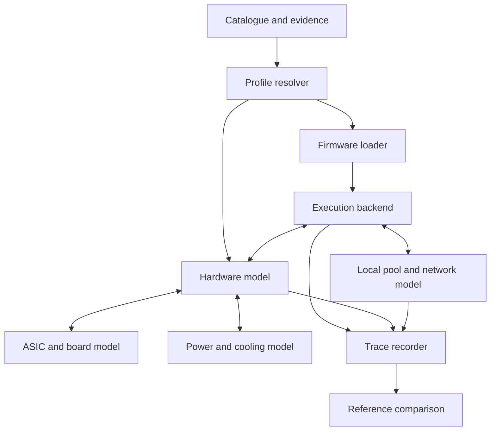

# Simulator design basis

Read the [detailed simulator specification](simulator-specification.md) for the current requirements and proposed user workflows.
It adds mandatory low-rate operation, exact target resolution, local and remote tests, and native dashboard access.
This document retains the earlier design evidence and reference implementations.

This document defines a proposed Bitcoin ASIC simulator. It does not report a completed simulator.
The catalogue supplies evidence and input files. It does not prove that all combinations can run.

## 1. Define the result

A device has more than a model name. A useful device profile contains these items:

- The exact miner model and cooling type.
- The control-board part number, revision, processor, and memory.
- The hashboard part number, revision, chip type, and chip count.
- The power supply, voltage range, and control protocol.
- The fan, temperature sensor, and cooling interfaces.
- The firmware file, version, checksum, and installation method.
- The boot files, partition map, device tree, and persistent settings.
- The pool protocol, Bitcoin SHA-256d work format, and management API.

The simulator must reject an unsupported combination with a clear reason.
An absent compatibility record means **unknown**. It does not mean **compatible** or **incompatible**.
Two control boards with the same processor can have different wiring and boot requirements.

## 2. Keep four execution modes

| Mode | Firmware execution | Suitable tests | Main limit |
| --- | --- | --- | --- |
| API model | No original firmware | Fleet tools, alerts, configuration, error handling | Cannot prove firmware behavior |
| Source with device adapters | Rebuilt source with recorded changes | Mining logic, job handling, drivers, tuning policy | Does not test the original binary |
| Process emulation | Selected original programs with system-call adapters | Miner daemon, API, configuration | Does not reproduce the original kernel or boot chain |
| Board emulation | Original or reconstructed boot stack with device models | Boot, update, driver, and recovery paths | Needs exact peripherals and memory maps |

Every run must state its mode. Results from different modes are not interchangeable.
Patched firmware must have its own checksum and patch manifest.

QEMU has a Zynq machine model. Its documented peripherals do not establish support for a miner's programmable-logic design.
The miner-specific registers and devices still need evidence. [QEMU board documentation](https://www.qemu.org/docs/master/system/arm/xlnx-zynq.html)

Espressif supplies an ESP32-S3 QEMU port.
The `virtualAxe` project adds a virtual ASIC path to patched mining firmware.
It is a useful prototype reference. It is not proof of support for every Bitaxe release.
[Espressif documentation](https://docs.espressif.com/projects/esp-idf/en/latest/esp32s3/api-guides/tools/qemu.html), [virtualAxe](https://github.com/mars-llm/virtualAxe)

## 3. Use a layered design



The profile resolver selects evidence-backed parts.
The firmware loader checks the image and its dependencies.
The execution backend runs the selected mode.
The trace recorder uses one simulation clock for all components.

## 4. Inspect the firmware before execution

1. Select an artifact from the catalogue.
2. Check its SHA-256 checksum.
3. Check its publisher checksum or signature when available.
4. Identify the container format.
5. Record each file extracted from the container.
6. Record the parent artifact and extraction-tool version.
7. Identify each executable's processor, byte order, ABI, and interpreter.
8. Identify the kernel, device tree, bootloader, and root filesystem.
9. Record the flash offsets and partition sizes.
10. Record all missing components.

A web-update package can contain only changed files.
An SD recovery image can contain a complete boot layout.
These two artifacts can require different execution backends.

The collection includes tools for BMU containers, UBI/UBIFS, SquashFS, JFFS2, and general firmware inspection.
Their source snapshots are not installed toolchains.
The inspection report lists outer archive members. It does not claim full filesystem reconstruction.

## 5. Model the board interfaces

Each device adapter must define the information below.
Unknown fields must remain unknown until measured or documented.

| Interface | Required model data | Required test evidence |
| --- | --- | --- |
| UART | Baud rate, framing, CRC, reset order, timeouts | Startup and work-submit traces |
| SPI | Mode, clock, select line, register map | Read/write sequences |
| I2C/SMBus | Addresses, registers, limits, error behavior | Sensor and power-control captures |
| USB | Descriptors, endpoints, transfers, reset behavior | Host traces and device firmware |
| Memory-mapped I/O | Addresses, register width, interrupts, DMA | Driver source and register traces |
| GPIO | Direction, polarity, reset values | Board schematic and boot trace |
| Fan | PWM range, tachometer relation, stall detection | Control response at measured speeds |
| Flash/EEPROM | Layout, IDs, calibration, write rules | Labelled dumps from owned hardware |
| Power supply | Commands, telemetry, startup delay, shutdown faults | Vendor protocol or measured bus trace |

An FPGA bitstream can implement an undocumented ASIC interface.
A processor emulator alone does not reproduce that interface.
An encrypted or signed component can also prevent a complete reconstruction.

## 6. Model hashing at two levels

The functional model accepts work and returns real, verifiable solutions.
The performance model schedules events from a declared hash-rate model.
Synthetic performance events must never be labelled as verified solutions.

For a uniform 256-bit Bitcoin proof-of-work result, the probability of a valid result is:

```text
p = (target + 1) / 2^256
expected_solution_rate = hashes_per_second * p
expected_wait_seconds = 1 / expected_solution_rate
```

This equation assumes independent, uniformly distributed results.
The mining model must implement Bitcoin header serialization and double SHA-256.
It must distinguish the block target from the pool share target.
The ASIC adapter must also implement the device's byte order, work packet, and nonce response format.
Some drivers send a SHA-256 midstate. Other interfaces use a different work packet.
Record the exact driver path used by each firmware revision.

The [genesis-header fixture](../fixtures/bitcoin/genesis-header.json) provides one checked example.
Its constants and expected hash come from the pinned Bitcoin Core source.
Run `python3 scripts/verify_bitcoin_fixture.py` to check the 80-byte header, its hash, and its target.
This fixture does not test an ASIC packet, pool session, or firmware binary.

A seeded event generator permits repeatable performance tests.
A local pool with an easy target permits functional solution tests.
The pool must verify the actual submitted Bitcoin header.
Changing a displayed hash rate does not create valid work.

The job model must include these cases:

- New jobs and clean-job transitions.
- Extra nonce, nonce range, version, and timestamp changes.
- Pool difficulty and target changes.
- Duplicate, stale, invalid, and valid shares.
- Pool disconnects, failover, retries, and timeouts.
- Version-rolling and protocol-extension negotiation.
- Stratum V2 channel setup, encryption, and job messages where applicable.

The archived protocol specifications and source implementations define the wire formats.
Each test must name the specification version and the implementation commit.

## 7. Model power and cooling

A first model can use calibrated tables for frequency, voltage, power, and hash rate.
It must identify the hardware revision used for calibration.
Vendor headline specifications are reference values. They are not a complete calibration curve.

A simple thermal model can use the following equation:

```text
C * dT/dt = P - (T - ambient_temperature) / R
```

`C` is thermal capacitance in J/K. `R` is thermal resistance in K/W.
Both values require measured data. They must not be invented from the rated power.
Air, immersion, and water cooling need different profiles.
The model must preserve sensor lag, fan response, and firmware shutdown behavior.

Fault injection should include a missing board, missing chip, stuck sensor, fan failure, power limit, CRC error, and delayed response.
Each fault must enter through the same interface that the real firmware reads.

## 8. Keep execution contained and repeatable

The first execution target should use a local pool and a private virtual network.
Downloaded miner firmware must not receive the host filesystem or the production network.
The run configuration must state all permitted external endpoints.

Each run record must contain:

- The profile ID and schema version.
- All input checksums and source commits.
- The execution backend and its version.
- All patches, adapters, and missing devices.
- The random seed and virtual-clock policy.
- The pool configuration and job fixture hashes.
- The output trace, observed results, and test verdict.

## 9. Define acceptance gates

| Gate | Evidence required |
| --- | --- |
| Image identified | Container, architecture, dependencies, and hashes recorded |
| System starts | Repeatable boot trace and stable management interface |
| Hardware detected | Correct board and chip enumeration |
| Functional mining | Local pool independently accepts actual valid solutions |
| Fault behavior | Reference faults cause the expected responses |
| Update and recovery | Version transition and persistent state match the selected profile |
| Timing model | Measured traces establish an error range |
| Physical model | Measured power and thermal data establish an error range |

Passing one gate does not imply that later gates passed.
The current collection has no locally tested firmware-to-hardware compatibility claims.

## 10. Start with these targets

1. Implement catalogue resolution and profile validation.
2. Implement a local pool and deterministic test jobs.
3. Reproduce one open ESP32-S3 miner through a recorded source adapter.
4. Compare it with the archived `virtualAxe` design.
5. Add one legacy Linux miner with published driver source.
6. Implement its board interface from source and measured traces.
7. Add a proprietary firmware process with the same interface contract.
8. Add full board emulation only when the necessary boot and peripheral data exist.
9. Add each new hardware revision as a separate, tested profile.

The initial profile fields are in [the version 1 profile schema](../catalog/schema/simulation-profile.schema.json).
The [version 2 requirements](simulator-specification.md#5-versioned-data-contracts) replace the single validation level with independent capability results.
The remaining research tasks are in [the gap table](../catalog/csv/gaps.csv).

## 11. Reuse the collected reference implementations

These projects address different parts of the design. None establishes support for every miner or firmware version.
The collection did not execute these programs.

| Reference | Useful starting point | Limit |
| --- | --- | --- |
| [virtualAxe](../catalog/index.html#entities/platform-tool-virtualaxe) | ESP32 mining firmware with a virtual ASIC path | Requires the project's firmware changes and device assumptions |
| [Canaan fake-avalon](../catalog/index.html#entities/canaan-fake-avalon) | Host-driver tests and saved test data | Check the exact Avalon protocol and fixture generation |
| [HashFast G-1 emulator](../catalog/index.html#entities/hashfast-g1-emulator) | ASIC packet handling, queues, status, and job timing | Returns artificial nonces; it does not compute valid Bitcoin proof of work |
| [Legacy Braiins protocol simulator](../catalog/index.html#entities/braiins-stratum-simulator-legacy) | Share arrival, latency, and stale-share experiments | Uses historical protocol drafts and simulated events |
| [Legacy BOSminer source](../catalog/index.html#artifacts/braiins-legacy-bosminer-fork) | BM1387 driver, board control, FPGA interface, and protocol code | A preserved source fork is not a complete validated S9 emulator |

Read [the ESP image layout index](../catalog/parts/open/esp-image-layouts.jsonl) for archived ESP firmware images.
It records parsed processor IDs, image segments, partition offsets, and available application metadata.
Image checksums do not prove that a PCB matches the image or that secure boot will accept it.

Use [the archive member database](../catalog/archive-members.sqlite) to find the implementation paths.
Use [the source identity report](../reports/source-identity.jsonl) to check recorded commit markers.
Locally reconstructed Git trees and members extracted from parent archives have distinct provenance labels.
