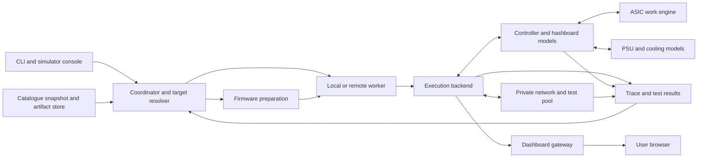

# Bitcoin ASIC simulator specification

Version: 0.3. Date: 19 October 2026. Status: implementation specification.

This document specifies the simulator to build in this repository.
The repository now contains Rust component tools and an isolated cgminer source experiment.
The complete miner runtime and dashboards are not implemented. No exact physical target has passed the release gates.
This document retains the complete required interface. The README identifies the commands that are implemented and tested.

The user requires Bitcoin ASIC devices only, very low hash rates, local and remote tests, and access to miner dashboards where possible.
The guides use short sentences and defined technical terms. Formal ASD-STE100 conformance is not certified.

## 1. Required result

Build one platform that can compose a virtual miner from exact hardware models.
Add a profile for each known hardware revision. Reuse components where evidence supports reuse.
Load a selected firmware artifact into that profile. Run its control logic and services.
Model hashboards, power supplies, cooling, storage, and network interfaces at the points that the firmware uses.

The virtual hashboards must perform valid Bitcoin work at a very low rate.
They must retain the device's chip count, chain topology, packet formats, register behavior, and fault behavior.
A low hash rate must be an ordinary operating mode of the simulator.
It must not require synthetic successful shares.

The system must support these user tasks:

1. Find a device and its exact hardware variants.
2. Select a downloaded firmware build and its installation path.
3. See whether the combination can run and which parts remain unknown.
4. Start the miner on the local computer or a remote worker.
5. Open the firmware's own dashboard when its web service can run.
6. Configure a local test pool and observe valid shares.
7. Inject hardware faults and inspect the firmware response.
8. Test every catalogue item and produce a report that includes blocked items.
9. Compare firmware versions on the same virtual hardware.
10. Save, restore, and reproduce a run from its input hashes.

The system must not infer that arbitrary firmware can boot on arbitrary hardware.
For each requested combination, it must execute a supported test or give a precise reason why execution is blocked or rejected.
An unknown relationship must remain unknown.

## 2. Execution identity and support claims

Use four execution modes. Record the mode in every run, page, and report.

| Mode | What runs | Valid claim |
| --- | --- | --- |
| `board-emulation` | Guest CPU instructions, selected boot components, original kernel, services, and device drivers | Behavior of the recorded board model and boot path |
| `process-emulation` | Selected original guest programs with an adapted operating environment and device interface | Behavior of those programs at the implemented interfaces |
| `source-adapter` | Source rebuilt with documented virtual-device or low-rate changes | Behavior of that source build and its changes |
| `api-model` | Simulator code implements a management interface | Behavior of the API model only |

Use separate fields for `firmware_identity`, `environment_identity`, and `boot_entry`.
`firmware_identity` must be `original-bytes`, `rebuilt-source`, `patched-binary`, or `not-executed`.
Use `not-executed` for an API model. Its associated firmware record describes a reference interface, not an executed image.
`environment_identity` must list substituted kernels, libraries, device trees, drivers, services, clocks, and device adapters.
`boot_entry` must be `reset`, `bootloader`, `kernel`, `process`, or `none`.

An unchanged application running with an injected library is an adapted process environment.
A direct kernel start does not test the boot ROM or preceding bootloader.
A rebuilt source tree does not establish that a vendor binary behaves the same way.
An API model must not pass a firmware-execution gate.

Support belongs to this exact key:

```text
hardware_profile_hash + firmware_bundle_or_reference_hash + execution_mode
  + adaptation_hash + backend_build_hash + scenario_hash
```

Each test result must additionally pin the complete resolved run-specification hash, suite hash, and independent verifier hash.
The resolved specification includes the seed, hash cap, low-rate settings, clock policy and epoch, network policy, persistent-state fixture, and all resource and timeout budgets.
Use this complete test identity for resume and cache decisions.
Per-attempt run IDs and creation timestamps are output metadata, not input hashes.
Secrets use versioned references in the lock file; do not export their values.

Keep support claims per capability. Boot, web UI, mining, recovery, and thermal behavior can have different results.
Do not represent them with one highest validation level.

## 3. Catalogue resolution and complete coverage

### 3.1 Exact targets

A target is a resolved hardware profile plus a firmware bundle and execution mode.
A marketing model can resolve to several targets.
Several marketing models can reference the same hardware profile when evidence proves that identity.

The resolver must use these inputs:

- Device and board record IDs from the catalogue.
- Control-board PCB revision, SoC, CPU, memory, and storage type.
- Hashboard revision, ASIC revision, chain count, and chip count per chain.
- Board controllers, PIC or other MCU firmware, EEPROM data, and calibration data.
- PSU model, revision, control interface, and startup sequence.
- Cooling type and sensor layout.
- Exact firmware artifact SHA-256 and artifact-level target constraints.
- Required starting firmware, recovery image, bootloader, and update order.
- Source evidence, unresolved conflicts, and unknown fields.

Do not expand a firmware-family relationship into support for every file attached to that family.
Apply model, controller, flash, signature, and version constraints to each artifact.
The current [device matrix](../reports/device-matrix.csv) supplies candidate relationships. It is not an executable target list.

### 3.2 Inventory accounting

The planner must account for every main-scope device, hardware component, firmware entity, and firmware artifact in a frozen catalogue snapshot.
It must retain missing downloads, LFS references, damaged files, and incomplete update packages as blocked records.
Tools, documents, and metadata must retain their correct roles. They are not miner boot images.

Use these plan states:

| State | Meaning |
| --- | --- |
| `runnable` | Inputs, exact target mapping, backend, and required models are present |
| `blocked` | A named input or capability is missing |
| `unknown` | Evidence does not establish the pairing or required hardware identity |
| `incompatible` | Evidence establishes a conflict, or a required architecture or interface conflicts |
| `not-applicable` | The artifact or component has no standalone miner-execution role |

An unsupported implementation is `blocked`, not evidence of hardware incompatibility.
Unknown registers can block a capability even after a target initially starts.
Each state needs a reason code, evidence links, and a next action.

The default plan must include all relevant pairs and all unassigned inventory items.
An optional Cartesian plan must account for every device/profile and firmware candidate pair.
It may store rejection rules and paged rows to limit size.
It must not omit rows without reporting the total and the selection rule.
Do not execute known incompatible pairs during normal conformance tests.
Explicit negative tests may verify their rejection.

Deduplicate identical bytes for storage and identical resolved execution keys for scheduling.
Retain the result for every catalogue alias and every constraint-bearing record.

## 4. Architecture and implementation boundaries



Use Rust as the first choice for new simulator code.
Implement the CLI, coordinator, worker, resolver, pool, and shared ASIC/device-state core in Rust.
Use C as the second choice, where an emulator interface or an existing component requires it.
Use another language only when Rust and C cannot reasonably meet a necessary requirement. Record the reason and affected component in the README.
Keep useful existing Python catalogue tools and consume their exports. Do not rewrite them solely to change language.
Preserve upstream firmware and native dashboard assets in their original languages.
Keep necessary build and browser-test tooling, with its purpose recorded.
Use stable, versioned interfaces between the runtime and backend device modules.
Keep register and byte-stream operations inside the worker. Do not send each bus operation over the remote control connection.

Define these backend operations:

```text
probe_capabilities() -> backend capabilities and build hash
prepare(locked_target) -> immutable prepared bundle
start(run_spec) -> run ID and endpoints
advance(until_virtual_ns) -> events or unsupported-clock result
pause() / resume() / reset(reset_kind)
snapshot() / restore(snapshot_id)
inject(fault_spec) -> scheduled fault ID
collect() -> traces, state, coverage and checksums
stop(grace_period) -> final result and resource cleanup
```

The backend must reject unsupported operations explicitly.
Process emulation does not automatically provide snapshots or deterministic clocks.
Restart from the same immutable inputs when a backend cannot snapshot safely.

Use one private network and one writable storage overlay per run.
Keep the pool and the timing-sensitive hardware models on the same worker as the guest.
Remote control latency must not determine ASIC response latency.

Use explicit lifecycle states: `resolving`, `preparing`, `ready`, `booting`, `starting-services`, `running`, `paused`, `stopping`, `stopped`, `failed`, and `lost`.
An emulator process starting is not evidence that the miner or dashboard is ready.
Make stop and cancellation idempotent. Worker loss must retain an incomplete result and the last collected evidence.

## 5. Versioned data contracts

The existing [version 1 profile schema](../catalog/schema/simulation-profile.schema.json) is an initial proposal.
Implement a version 2 contract before the first simulator release.
Keep a migration tool. Do not silently reinterpret the version 1 `validation.level` field.

### 5.1 Hardware profile

| Group | Required fields |
| --- | --- |
| Identity | Schema version, profile ID, revision, device aliases, evidence IDs, content hash |
| Controller | Board ID and PCB revision, SoC, CPU type/count, ISA, endian, reset entry, address map |
| Memory | RAM layout, ROM layout, reserved ranges, declared versus measured values |
| Storage | Bus, chip ID, size, geometry, ECC/OOB rules, partitions, boot order, write protection |
| Hashboards | Ordered slots, board revisions, ASIC types, chip counts, addresses, chain links, reset domains |
| Auxiliary controllers | MCU type, program hash or behavioral-model ID, EEPROM, board identity, calibration |
| Power and cooling | PSU, rails, startup dependencies, sensor locations, fans, pumps, cooling mode |
| Interfaces | Bus bindings, register maps, interrupts, DMA, transport timing, protocol implementation hashes |
| Model limits | Unknown fields, assumptions, unimplemented registers, calibration coverage |

Use `null` plus an explicit unknown record when evidence is missing.
Never use zero as a substitute for an unknown chip count, memory size, or timing value.
Each measured or inferred property must state its evidence type and confidence.

### 5.2 Firmware bundle

A bundle must include the original artifact and a manifest of all selected components.
Each component needs a parent artifact, byte range or archive member, SHA-256, role, load address or partition, and preparation-tool identity.
List the kernel, device tree, bootloader, root filesystem, applications, web assets, shared libraries, module versions, MCU code, and external dependencies when present.

Keep installation paths as a directed graph.
For example, a factory recovery image can be a prerequisite for a web update.
Record required starting versions, controller revision, storage layout, signatures, and resulting persistent state.

### 5.3 Run specification

The run specification must pin the target, firmware bundle, backend build, adapters, scenario, seed, clock policy, network policy, resource budget, and dashboard policy.
Use absolute resolved artifact identities in the lock file. User-facing names can remain aliases.
Resolve mutable tags and paths before execution.

The default low-rate configuration must have the following meaning.
This is a field example, not a complete runnable profile:

```yaml
schema_version: "2.0"
hashing:
  mode: functional
  cap_hps_total: 10000
  distribution: weighted_by_enabled_cores
  actual_rate_measurement: true
low_rate:
  enabled: true
  share_interval_goal_seconds: 5
  expected_rate_source: measured_worker_rate
  mining_timeout_policy: scale_to_effective_rate
  firmware_adaptation: use_recorded_target_variant
clock:
  policy: realtime
network:
  egress: deny
  pool: worker-local-test-pool
dashboard:
  source: native-if-available
  listen: "127.0.0.1:18080"
```

The cap is a maximum requested aggregate rate. It is not a promise that the host can reach that rate.
The model must report measured throughput and the cap separately.

### 5.4 Results

Every gate result must contain its status, evidence, actual values, expected values, tolerance, clock domain, and test version.
Use `pass`, `fail`, `blocked`, `inconclusive`, `not-run`, or `not-applicable`.
A timeout caused by an inadequate search budget is not a valid-share pass.
Preserve the full result history. A later pass must not erase an earlier failure.

## 6. Firmware preparation and boot paths

Preparation must perform the following operations without executing installer scripts on the host:

1. Verify file identity and read all recorded integrity conflicts.
2. Resolve Git LFS objects and reject unresolved pointers as payloads.
3. Parse containers within a disposable preparation environment.
4. Limit extracted size, file count, recursion, and parser time.
5. Reject paths that escape the preparation directory, including escaping links.
6. Identify CPU architecture, ABI, endian, interpreter, and required libraries.
7. Build the partition and component map.
8. Determine whether the artifact is a boot image, update, installer, recovery image, MCU image, or host tool.
9. Construct the required starting storage image from verified components.
10. Record each transformation and hash the result.

An installer must run only inside the selected emulated environment if its behavior is part of the test.
An update test must use the firmware's update handler where that handler can run.
An offline reconstructed root filesystem is a separate preparation method.

Model NAND page and erase geometry, bad-block handling, ECC, and OOB data when the boot path depends on them.
Model NOR erase rules, eMMC/SD block access, environment CRCs, redundant boot partitions, and persistent configuration as applicable.
Preserve device IDs and calibration data from the selected fixture.
Use simulator-owned identities for invented test devices and label them as such.

For signed or encrypted images, retain the signature and verification path.
Use supplied or otherwise authorized test keys only when the profile includes them.
If required key material or plaintext is unavailable, report the affected path as blocked.
A modified boot path or bypassed check must be a separate adapted target with a separate result.
It must not pass original secure-boot or recovery acceptance.

## 7. Controller families and backend work

The table below defines implementation work. It does not claim that these miners already run.
Choose a backend after a small executable test proves the required CPU and device interfaces.
Pin the exact backend source and build inputs in the target lock.

| Family or evidence group | Required work | Main boundary |
| --- | --- | --- |
| ESP32 and ESP32-S3 open miners | Exact CPU, flash/partition map, boot selection, UART ASIC chain, I2C devices, GPIO, watchdog, network driver path | A port for one ESP chip does not establish another chip or board; substituted network drivers are adaptations |
| Zynq-7000 controllers | CPU system, interrupt controller, storage, Ethernet, clocks, FPGA register blocks, FIFO/DMA and board buses | A generic Zynq machine does not include miner-specific programmable logic |
| TI AM335x / BeagleBone controllers | CPU and memory, GPMC/NAND, timers, UART/I2C, GPIO, Ethernet, PWM; PRU only where used | Exact boot storage and enabled peripherals differ between images |
| Amlogic A113D-class evidence | Image-specific boot chain, storage, MMIO, reset and clock tree, ASIC serial interfaces | CPU instruction support alone is insufficient |
| CV1835-class evidence | Exact eMMC or SPI-NAND boot layout, CPU, memory, clocks, UART/I2C/GPIO and board adapters | Development-board RAM defaults must not be applied to a miner without evidence |
| Older AR9331 and other MIPS controllers | Image-specific ISA, endian, flash map, Ethernet, UART, GPIO and timers | Resolve the actual board and root filesystem before selecting a generic machine |
| WhatsMiner H3 | H3 controller model plus exact vendor board wiring, storage and peripheral contracts | An Orange Pi machine is a starting reference, not a WhatsMiner board profile |
| WhatsMiner H6 / H6os / H616 | Separate controller targets, boot containers, storage, clocks, UART and PSU interfaces | Do not merge H3 and H6-family architectures or memory maps |
| Canaan controller and MM systems | Outer controller, intermediate controllers, ASIC links, sensor/PSU buses, and each program boundary | Linux, K230, K210, MCU and MM roles must follow the exact product evidence |
| Legacy USB and serial ASIC devices | USB descriptors/endpoints, bridge chips, queue protocol, board MCU, ASIC protocol; host miner process | Emulating a host driver alone does not run the device's MCU firmware |
| AVR32 and other legacy MCUs | CPU backend if device firmware must execute, or a separately labelled behavioral controller | Unsupported ISA execution must remain blocked rather than replaced silently |
| ePIC replacement controllers and modern proprietary boards | Exact revision, supported harness/hashboard/PSU interfaces, image format, boot chain, APIs | Controller replacement claims require exact board and firmware constraints |
| Auradine, Bitdeer, Proto and other incomplete platforms | Resolve the physical controller, executable components, buses, and signed dependencies first | A product manual or firmware target label is not a complete circuit model |

Start from the [Bitmain boot profiles](../catalog/parts/bitmain/platform-boot-profiles.jsonl),
[ESP image layouts](../catalog/parts/open/esp-image-layouts.jsonl),
[vendor evidence](vendors.md), and [additional vendor evidence](emerging-vendors.md).
DTB memory values are declarations from an image. They are not measurements of installed RAM.
Apply parent bus address and size cells before interpreting device-tree register addresses.

QEMU documents Zynq and Orange Pi H3 machine models with specific peripheral coverage.
Espressif documents an ESP32-S3 QEMU fork with CPU, memory, and selected peripherals.
These are backend starting points. Miner support needs the remaining interfaces and tests.
[QEMU Zynq](https://www.qemu.org/docs/master/system/arm/xlnx-zynq.html),
[QEMU Orange Pi](https://www.qemu.org/docs/master/system/arm/orangepi.html),
[Espressif QEMU](https://docs.espressif.com/projects/esp-idf/en/latest/esp32s3/api-guides/tools/qemu.html).

## 8. Device model contract

Each model must expose reset, read, write, advance-time, fault, serialize-state, and coverage operations.
Record the implementation version and state-schema version.
Reject incompatible snapshot versions.

| Interface | Required behavior |
| --- | --- |
| MMIO | Width, endian, alignment, reset values, reserved bits, side effects, interrupt routing, DMA addressing |
| UART | Baud/divisor effects, framing, FIFO size, partial frames, CRC, overflow, reset and delayed responses |
| SPI | Mode, chip selection, bit order, transaction boundaries, busy state and timing |
| I2C / SMBus | Addresses, register pointers, repeated start, ACK/NACK, busy state, PEC where required |
| USB | Device/configuration descriptors, endpoint types, transfers, stalls, reset, disconnect and reconnect |
| GPIO | Direction, active level, pull state, edge behavior and reset domains |
| Storage | Identification, offsets, erase/program rules, failures, persistence and recovery |
| Sensors | Register encoding, units, conversion delay, unavailable values and fault bits |
| Fans / pumps | Command range, tachometer pulses, inertia, missing feedback and stall behavior |
| PSU | Identification, enable sequence, limits, telemetry, shutdown and recovery faults |

Do not return successful responses for every unknown command.
Use the documented default if one exists. Otherwise record the access and block the affected conformance gate.
Exploratory runs may continue with declared stubs. Their results must list every stub used.
Strict conformance requires zero unexplained accesses on the path under test.

A shared chip implementation must be configured by the exact board wiring and revision.
Keep chip identity, board identity, slot address, and serial number separate.
Model partial chain failure, missing chips, disabled cores, duplicate addresses, and reset propagation.

## 9. ASIC work and very low hash rates

### 9.1 Default functional operation

`functional` hashing is the default.
Start with an aggregate cap of 10,000 hashes per second and one CPU hashing worker.
Permit any lower positive cap. Permit a higher cap within the run's resource budget.
Do not reduce the emulated chip count to implement the cap.
Distribute work across enabled virtual cores according to the profile's scheduling rule.

Decode the real work packet. Restore SHA-256 midstate as compression state when the protocol supplies it.
Do not hash the serialized midstate as new message bytes.
Implement the exact tail, padding, endian, nonce, version, and time rules.
Return only actual solutions that meet the ASIC's active result filter.
The pool must reconstruct the complete Bitcoin header and verify the share independently.

Track three rates separately:

- Host-computed hashes per wall-clock second.
- Emulated work completed per guest-clock second.
- Firmware-reported hash rate and its measurement window.

The simulator console must label these values.
The native dashboard must show the values produced by its firmware. Do not rewrite its reported rate in the gateway.

### 9.2 Low-rate timeout policy

Low-rate adaptation is a required feature, not an optional workaround.
Apply these steps in order:

1. Measure the worker's actual functional rate, subject to the configured cap.
2. Set the local pool share target for the requested share interval.
3. Use a guest-supported setting to request the easiest ASIC result filter permitted by the exact protocol.
4. Configure expected rate, startup self-test work, and mining timeout settings where the guest exposes them.
5. Extend simulator-owned work deadlines from the effective rate and active result filter.
6. Use a recorded low-rate firmware variant when fixed guest thresholds still prevent operation.

Changing a simulator deadline does not change a deadline hard-coded in guest firmware.
For source firmware, keep a minimal patch for expected rate, self-test work, or mining timeouts when needed.
For binary firmware, permit a documented, reproducible adaptation only when its exact affected behavior is understood.
Record original hash, modified hash, offsets or patch source, reason, and tests.
Keep the original artifact unchanged.
Do not claim that a low-rate adapted result validates the original firmware's production-rate watchdog behavior.
The ASIC model must obey the filter actually programmed by the guest.
Any simulator override of that filter is also an adaptation. Record it and keep register readback and result behavior consistent.

Do not multiply every timeout by the hash-rate reduction.
Keep bus framing, boot, authentication, cooling, and network timeouts in their proper clock domains.
Scale only deadlines whose meaning depends on completed mining work, unless a recorded guest-clock adaptation is required.

For an active result target `T` and actual search rate `H`:

```text
p = (T + 1) / 2^256
expected_result_interval = 1 / (H * p)
approximate_probability_of_no_result_after_t = exp(-H * p * t)
```

Use the ASIC result target when estimating ASIC response intervals.
Use the intersection of the ASIC result filter and the share filter when estimating accepted share intervals.
For two numeric upper-bound targets, the effective target is `min(T_ASIC, T_share)`.
For a ticket mask or another non-threshold filter, calculate the actual intersection probability.
Raw submissions and accepted shares can have different rates when the firmware forwards unsuitable results.
These targets can differ from each other and from the Bitcoin block target.
The approximation assumes uniform independent hashes and does not replace deterministic test vectors.

Allow fractional pool difficulty if the protocol and guest support it.
An easy pool target cannot override a harder fixed ASIC ticket filter or a guest minimum difficulty.
When that limit applies, use a recorded low-rate adaptation, a valid fixed-work scenario, or report the general-work test as blocked.
Never manufacture a successful nonce to remove a timeout.

### 9.3 Fixed work and performance studies

Provide `known-work` tests with complete fixed jobs and known valid nonces.
The coinbase, extra nonce, Merkle path, header, nonce range, and job ID must agree.
Exercise the real packet and result paths. Verify each result independently.
These tests validate selected work vectors and responses. They do not prove arbitrary-work throughput.

Provide a separate `synthetic-performance` mode for production-rate telemetry and tuning studies.
Label every synthetic event and derived result.
Do not send synthetic successful shares to an ordinary pool or count them as valid Bitcoin work.
If a test deliberately injects an invalid result, expect the independent verifier to reject it.

The archived HashFast and BFL simulators contain useful protocol behavior but artificial nonce models.
They must not supply the valid-share oracle.
See the [design references](simulator-design.md) and [BFL contract](../catalog/parts/open/bfl-simulator-contract.json).

## 10. Clock, scheduling, and repeatability

Use integer virtual nanoseconds for device events.
Define stable ordering for events with the same timestamp.
Record PRNG algorithm, seed, initial RTC epoch, and input event order.
Record all external nondeterministic inputs needed for replay.

Support these clock policies:

| Policy | Use | Required disclosure |
| --- | --- | --- |
| `realtime` | Interactive dashboard and ordinary low-rate mining | Actual guest/wall ratio and missed scheduling deadlines |
| `paced-virtual` | Slow all relevant guest activity to allow functional hashing | Time ratio and affected firmware timers |
| `deterministic` | Repeatable device and protocol tests | Backend support, event ordering, controlled pool and network inputs |

A backend must advertise which clocks it can implement.
Do not advertise deterministic board execution from a seeded ASIC model alone.
All emulated controllers in a run must use compatible clocks.
Device time must not advance merely because a dashboard polls a sensor.

During pause, pause mining, device timers, and the worker-local pool as required by the clock policy.
Keep host control and dashboard session expiry in wall time.
Reports must identify any session expiry caused by a long pause.

Take snapshots at a consistent barrier across CPUs, device queues, interrupts, timers, virtual clock, PRNG, flash overlays, EEPROM, and the worker-local pool.
Record any network sessions that cannot be restored.
If the backend cannot capture all required state, reject a complete-snapshot claim and offer a restart from the recorded initial state.
Cold power loss, warm reset, factory reset, and recovery must have separate persistence rules.

## 11. Power, temperature, and faults

Separate host CPU power from emulated miner power.
Low host hash throughput does not measure the real miner's electrical efficiency.
Provide an explicit low-rate operating model and a separate calibrated production operating model.
Mark uncaptured voltage/frequency regions as uncalibrated.

Use measured lookup tables or a declared thermal model with units, parameters, revision, and error bounds.
For a first-order model, `C*dT/dt = P - (T - ambient)/R` requires measured or explicitly assumed `C` and `R`.
Assumed parameters permit exploratory tests only. They do not pass physical calibration.

Model rail enable order, ramp delay, current limits, sensor lag, fan inertia, pump feedback, and thermal shutdown where the firmware reads them.
Inject faults through the device interface, not by changing the final dashboard text.

Required scenarios include missing hashboard, broken chain, missing chip, disabled core, wrong board identity, corrupt EEPROM, CRC error, delayed response, FIFO overflow, PSU refusal, voltage limit, fan stall, pump failure, stale sensor, overtemperature, and network loss.
Each scenario must name the applicable hardware and expected response.
Physical protection responses remain independent of low-rate mining timeouts.

## 12. Test pool and network

Create the test pool inside the worker's private network.
Support the protocol required by the target: Stratum V1, specific V1 extensions, Stratum V2, or a documented legacy protocol.
Implement and pin the exact protocol version and negotiation behavior.
Stratum V2 tests must include the required transport security and channel setup.
Do not claim V2 support from a V1 proxy session alone.

Generate deterministic jobs for conformance tests.
Reconstruct submitted work independently of the ASIC model.
Test valid, invalid, duplicate, stale, and out-of-range submissions.
Test clean-job transitions, job replacement, target changes, extra-nonce changes, version rolling, timestamp bounds, reconnect, failover, and lost acknowledgements.

Use the [Bitcoin header fixture](../fixtures/bitcoin/genesis-header.json) as one base vector.
Add multiple midstate, endian, nonce, Merkle-root, and boundary-target vectors before claiming ASIC functional support.
Use a separate verifier implementation and known Bitcoin vectors to avoid checking a model with the same defective code path.

Add an end-to-end Bitcoin Core regtest acceptance test.
Generate fresh work, let the executing miner firmware send it through the simulated ASIC, and return an actually computed solution through the same path.
Assemble the resulting block and obtain acceptance from an isolated Bitcoin Core regtest node.
Record the job, firmware submission, reconstructed header, block identity, node result, and chain-state change.
Do not replace this test with a node-generated block or a precomputed fixture.
This test proves the recorded local mining path. It does not establish production hash rate or public-network mining success.

Provide worker-local DHCP, DNS, and time services where the guest needs them.
Keep fixed vendor endpoints and development-fee traffic visible in the network report.
Default external egress to denied. A target that needs activation or a missing external service must report that dependency.
An explicit test service substitution changes the environment identity.

Do not connect to a public mining pool by default.
Do not scan, configure, or flash physical miners as part of a simulation run.
Remote execution means a remote simulator worker unless a separate future hardware-test mode is explicitly selected.

## 13. Native dashboards and simulator console

Run the firmware's own web server, API, CGI processes, and web assets when they are available.
The browser must operate against those guest services.
Copied static assets alone do not establish a working miner dashboard.

Record `dashboard.source` as `native`, `adapted-native`, `simulator-console`, or `unavailable`.
An API-only or headless miner can use the simulator console.
That console must display its identity clearly. It must not impersonate the vendor dashboard.

Use a separate origin for each run and isolate its cookies.
Prefer a root-path mapping such as `http://127.0.0.1:18080/`.
Do not depend on a `/miners/RUN_ID/` prefix, because some firmware uses absolute paths.
Different ports create different origins, but cookies are not isolated by port.
For concurrent dashboards, use distinct hostnames or IP addresses with correctly scoped cookies.
Verify hostname resolution and certificate names before publishing the endpoint.
If a deployment must share one IP, use a tested cookie-translation scheme or isolated browser contexts.
Do not claim transparent multi-miner browser support from unique ports alone.

The gateway must support these functions when the guest uses them:

- HTTP and HTTPS, redirects, uploads, downloads, streaming and long polling.
- WebSocket upgrades and server-sent events.
- Login, logout, cookies, CSRF checks, and session expiry.
- Pool settings, tuning settings, logs, restart, and firmware update through the real handler.

Keep gateway authentication separate from guest authentication.
Preserve per-run cookies and prevent requests from reaching another run.
Constrain any Host, Origin, Location, or cookie-domain translation to the recorded guest origin.
Record required proxy transformations in the endpoint manifest.
Do not silently remove browser security headers to make an iframe work. Open a separate page when embedding is blocked.
Pin a guest TLS certificate per target when necessary; do not disable upstream verification globally.

For remote use, support an SSH tunnel and an authenticated TLS gateway bound to a selected remote address.
Do not publish the guest's raw management API, serial console, debugger, emulator monitor, or worker control port.
Bind local endpoints to loopback by default.
Direct remote-IP publication requires an explicit address, TLS certificate with the correct IP identity, authentication, and a client access rule.

Each run must report its actual endpoints. If a requested port is occupied, fail clearly or allocate a new port only when automatic allocation was requested.
Never stop an unrelated process to obtain its port.

## 14. Local and remote workers

The first supported worker platform is 64-bit Linux on x86-64 or ARM64, subject to each backend's build support.
Other desktop hosts can use a Linux VM or a remote Linux worker.
The client must not promise that host CPU architecture provides the guest's board or peripherals.

`doctor` must check backend builds, CPU support, memory, free disk, required kernel facilities, artifact paths, local ports, and isolation capability.
The target must declare its resource estimate. The worker must refuse a job that exceeds the configured budget.
Measure real requirements during bring-up rather than publishing invented throughput benchmarks.

Use a dedicated worker identity and disposable execution environment.
Use OS isolation for guest processes and a VM boundary where the backend risk or access needs require it.
Mount inputs read-only. Do not expose the full host filesystem, host credentials, physical devices, or container-management sockets.
Set CPU, RAM, process, trace, disk, and wall-time limits.
Cleanup must remove only resources owned by the run.

The remote client uses SSH for worker registration, control, and tunnels in the first release.
Verify the server host key. The worker control service stays on loopback or a private Unix socket.
Use structured requests; do not construct shell commands from firmware names.
Future HTTPS control must use equivalent authenticated transport and worker identity checks.

Transfer only the locked input closure for the requested targets.
Use a content-addressed store with resumable transfers and hashes verified at the destination.
Workspace symbolic links must resolve to actual uploaded bytes; a link alone is not an artifact transfer.
Check redistribution and access constraints before a shared worker re-exports payloads to another user.

Use the same run specification, suites, and result format on local and remote workers.
Pin backend, firmware, and model hashes before comparing results.
The worker retains a run after a client disconnect and permits reconnection by run ID.
An interrupted transfer or lost worker must not produce a pass.

## 15. Proposed CLI contract

These commands define the required complete `md-sim` interface. The README identifies the implemented subset.
Upper-case tokens such as `TARGET_ID` are values the user must replace.
Commands that select a remote worker interpret file paths for certificates and credentials on that worker unless stated otherwise.
Input plans and `--out` report directories are client paths. Remote results must be transferred back to the client's output directory.

| Command | Required result |
| --- | --- |
| `doctor [--worker NAME]` | Host and backend capability report; actionable blockers |
| `catalog import --path PATH` | Read catalogue and create an immutable snapshot |
| `targets list [--device ID] [--firmware ID] [--runnable]` | Exact targets, modes, readiness and capability states |
| `targets explain TARGET_ID` | Hardware, artifacts, adaptations, evidence and blockers |
| `prepare TARGET_ID [--worker NAME]` | Resolve and verify the input closure; create a lock file |
| `run TARGET_ID [options]` | Start a run and return its ID and endpoints |
| `status RUN_ID [--worker NAME]` | Lifecycle state, actual hash rates, gates and endpoints |
| `logs RUN_ID [--follow] [--worker NAME]` | Guest and model logs with clock domains |
| `fault RUN_ID --scenario FILE [--worker NAME]` | Inject the selected fault through device interfaces |
| `snapshot RUN_ID [--worker NAME]` | Save consistent supported state or give an unsupported result |
| `restore SNAPSHOT_ID [--worker NAME]` | Create a new run with recorded state ancestry |
| `stop RUN_ID [--worker NAME]` | Stop and collect the run; keep reports and immutable inputs |
| `test TARGET_ID --suite NAME [--worker NAME]` | Run a suite in a fresh isolated instance |
| `workers add NAME --transport ssh --address USER@HOST` | Register a remote worker after identity verification |
| `workers check NAME` | Verify transport and required worker capabilities |
| `workers sync NAME --plan FILE` | Transfer and verify all inputs needed by the plan |
| `dashboard tunnel RUN_ID --worker NAME --listen ADDRESS` | Tunnel one native or simulator dashboard to local loopback |
| `dashboard publish RUN_ID --worker NAME [options]` | Publish one authenticated TLS endpoint on the worker |
| `dashboard test RUN_ID --url URL --client local [options]` | Run browser checks against that existing run from the operator's computer |
| `dashboard unpublish RUN_ID --worker NAME` | Remove the published endpoint |
| `matrix plan --scope all-catalogued [options]` | Freeze the complete coverage plan |
| `matrix run PLAN --workers LIST --suite NAME [options]` | Schedule runnable rows and retain every blocked row |
| `matrix report DIRECTORY --format html` | Write an offline report with drill-down and evidence |

`run` and `test` must accept `--hashing functional`, `--hash-cap-hps`, `--low-rate`, and `--clock`.
Functional low-rate mode is the default. `--low-rate` makes the choice explicit in a command.
`run` accepts `--dashboard ADDRESS` and `--name NAME`.
`test` and `matrix run` accept resource budgets, seeds, deadlines, and an output directory.
All commands must offer structured JSON output.

`dashboard test` must accept `--worker`, `--out`, `--miner-auth-file`, `--gateway-auth-file`, and `--ca-file`.
Its credential and CA files are client paths. These are separate from the gateway's worker-side user database.
It must check that the selected endpoint belongs to the requested run before changing settings.
Read-only page, login, live-data, and logout checks are the default.
`--allow-config-write` adds a reversible configuration round trip and restoration check on that existing run.
Record and report any failure to restore the prior setting.
This command does not create a fresh guest. It tests the selected local, tunneled, or published access path.

Use these exit codes: `0` requested checks passed; `1` tested behavior failed; `2` invalid command or configuration; `3` requested coverage is incomplete; `4` infrastructure failed or execution was interrupted.
Keep per-row results even when the aggregate command fails.
For mixed outcomes, use precedence `4`, `2`, `1`, `3`, `0` and preserve every cause in the report.

## 16. Local use procedure

Installation instructions must be added with the first executable release.
They must pin a release, backend packages, and checksums, and include one installation self-test.
Do not publish a `pip install` or container image name until that package exists.

The required local workflow is:

```text
md-sim doctor
md-sim catalog import --path .
md-sim targets list --device bitmain-antminer-s9
md-sim targets explain TARGET_ID
md-sim prepare TARGET_ID
md-sim run TARGET_ID --name lab-miner --hashing functional --hash-cap-hps 10000 --low-rate --clock realtime --dashboard 127.0.0.1:18080
md-sim status RUN_ID
md-sim logs RUN_ID --follow
md-sim test TARGET_ID --suite smoke --out reports/simulator/smoke
md-sim test TARGET_ID --suite conformance --out reports/simulator/conformance
md-sim stop RUN_ID
```

The S9 device ID is an existing catalogue example. It is not a claim that an S9 target is implemented.
The user selects `TARGET_ID` from the generated target list and `RUN_ID` from the start result.
The interactive instance and each test instance must use separate storage and network state.
Open the URL printed by `run`; the requested example is `http://127.0.0.1:18080/`.
Use `status` to determine whether it is a native dashboard or the simulator console.

## 17. Remote use and remote-IP dashboards

The following addresses are documentation examples. Replace them with the user's worker and permitted client addresses.
Install the same simulator release and required backends on the worker before registration.

```text
md-sim workers add lab --transport ssh --address minerlab@192.0.2.10
md-sim workers check lab
md-sim doctor --worker lab
md-sim prepare TARGET_ID --worker lab
md-sim run TARGET_ID --worker lab --hashing functional --hash-cap-hps 10000 --low-rate --dashboard 127.0.0.1:18080
md-sim dashboard tunnel RUN_ID --worker lab --listen 127.0.0.1:18080
```

The dashboard bind address in the remote `run` command refers to the worker.
The tunnel listen address refers to the user's computer.
Keep the tunnel running and open `http://127.0.0.1:18080/` on the user's computer.
The pool remains on the remote worker. `localhost` inside the guest is not the user's computer.
From a second terminal on the user's computer, test the actual tunnel endpoint:

```text
md-sim dashboard test RUN_ID --worker lab --url http://127.0.0.1:18080/ --client local --miner-auth-file /path/to/client/miner-auth.json --allow-config-write --out reports/simulator/tunnel-ui
```

For direct access through a remote IP, use a separate authenticated TLS gateway:

```text
md-sim dashboard publish RUN_ID --worker lab --listen 192.0.2.10:18443 --tls-cert /etc/md-sim/lab.crt --tls-key /etc/md-sim/lab.key --auth-file /etc/md-sim/dashboard-users --allow-client 192.0.2.0/24
md-sim dashboard test RUN_ID --worker lab --url https://192.0.2.10:18443/ --client local --gateway-auth-file /path/to/client/gateway-auth.json --miner-auth-file /path/to/client/miner-auth.json --ca-file /path/to/client/lab-ca.crt --allow-config-write --out reports/simulator/published-ui
md-sim test TARGET_ID --worker lab --suite conformance --out reports/simulator/remote
md-sim dashboard unpublish RUN_ID --worker lab
md-sim stop RUN_ID --worker lab
```

The gateway must report the URL, for example `https://192.0.2.10:18443/`.
The certificate must be valid for the address. Use a trusted test CA when needed.
The worker must check the firewall and access rule without changing unrelated firewall rules.
Do not place a password, private key, or access token in a URL or the command output.
Client credential files must use the documented credential-provider format and remain outside exported reports.
The release must supply a credential-configuration command and a sample without real secrets.
The gateway's user database must store password verifiers or reference an identity provider; it must not reuse a firmware password database.

The dashboard command tests the selected published `RUN_ID` from a separate client.
The subsequent target conformance command tests a fresh instance. It does not prove access to the published endpoint.
Automated matrix runs must create the selected gateway/tunnel policy for each applicable row and dispatch browser tests from a separate client agent.
Record that agent's build and network vantage point in the result.

If the native UI cannot operate through the gateway, report the failing requirement and retain tunnel access when supported.
Do not claim remote dashboard support until login, live data, and a configuration round trip pass from a separate client.

## 18. Test every hardware and firmware record

Freeze the catalogue snapshot before planning. Freeze the profile and backend registries with it.
Use the same plan for local and remote runs when comparing their results.

```text
md-sim matrix plan --scope all-catalogued --pairing relevant --include-blocked --out plans/all.json
md-sim matrix run plans/all.json --workers local --suite conformance --jobs 2 --resume --out reports/simulator/local
md-sim workers sync lab --plan plans/all.json
md-sim matrix run plans/all.json --workers lab --suite conformance --jobs 2 --resume --out reports/simulator/remote
md-sim matrix report reports/simulator/local --format html
md-sim matrix report reports/simulator/remote --format html
```

Use `--pairing cartesian` when the requirement is an explicit record for every requested device/profile and firmware pair.
The resolver must classify those pairs before scheduling them.
Use `--require-complete` on `matrix run` to return exit code 3 when any requested applicable item is blocked, unknown, or not run.
Without that flag, test failures still return failure, and the report must prominently state incomplete coverage.
Tests required for a claimed capability cannot be omitted by this aggregate policy.

`--resume` may reuse a completed row only when its complete resolved run-specification hash, suite hash, independent verifier hash, and all referenced input hashes match.
An interrupted row restarts from a clean overlay or a validated complete snapshot.
Changes to firmware, model, low-rate adaptation, clock, verifier, or scenario invalidate the relevant result cache.

Include these dimensions where they apply:

| Dimension | Required cases |
| --- | --- |
| Hardware | PCB, controller, storage, hashboard, chip, PSU and cooling variants |
| Firmware | Each available exact build, image type, required starting state and installation path |
| Execution | Original board path, adapted process path, source build and API model as separate results |
| Hashing | Low-rate arbitrary work, valid fixed work, and separately labelled synthetic studies |
| State | Cold boot, warm reset, persistent settings, clean install and update |
| Protocol | Required pool/API versions and negotiated extensions |
| Faults | Applicable device, power, cooling, storage and network cases |
| Access | Local browser, remote tunnel, direct remote-IP gateway where enabled |
| Worker | Local and remote builds; host architectures supported by that target |

The report must give separate denominators for inventory coverage, runnable targets, executed tests, passing capabilities, native dashboards, and calibration.
Count `blocked`, `unknown`, and `not-applicable` separately.
Do not report "100% supported" because every inventory row has a classification.
Do not count an API model as execution of its associated firmware artifact.

## 19. Acceptance tests and gates

Store each gate independently. Dependencies affect whether a gate can run, not whether it inherits a pass.
Each target must declare required gates for each advertised capability.

| Gate | Required acceptance evidence |
| --- | --- |
| G0 — Identity and preparation | All input hashes and component mappings verify; no required unresolved payload, geometry or architecture conflict |
| G1 — Execution | Selected entry point runs; guest logs and service readiness meet the declared boot budget; original/adapted identity recorded |
| G2 — Hardware enumeration | Expected boards, chains, chips, sensors and PSU enumerate; absence and wrong-identity cases behave as specified |
| G3 — Functional work | Independent verifier accepts actual correct work; at least two jobs and a clean-job transition are exercised; invalid and duplicate shares are rejected |
| G4 — Management and UI | API and native UI functions pass individually; login, live data, change/readback, restart persistence and logs work where implemented |
| G5 — Fault response | Faults enter the real guest-facing interfaces; alarms, retries, throttling and shutdown match the reference contract |
| G6 — Update and recovery | Selected transition, rejected wrong target, interrupted update, and recovery preserve the declared storage and settings behavior |
| G7 — Timing | Recorded reference traces and error bounds match the model in the stated clock mode; low-rate adaptations are identified |
| G8 — Physical behavior | Measured revision-specific power and thermal data establish limits and error bounds |
| G9 — Isolation and reproducibility | Egress policy, resource limits, per-run data separation, replay or restart identity, cleanup and remote access tests pass |

G3 must contain separate `arbitrary-work` and `known-work` subtests.
A fixed-work pass cannot fill an arbitrary-work result.
If minimum filters make arbitrary work too expensive at the selected cap, use the low-rate adaptation and record it.
If no valid adaptation exists, retain that subtest as blocked or inconclusive with its required search budget.

For G4, classify absent native UI as `not-applicable` only when the target is documented as headless.
A missing or unbootable UI from firmware that should have one is `blocked` or `fail`.
For G6, direct kernel boot cannot pass tests for the omitted boot ROM or bootloader path.
For G7/G8, supplier headline specifications alone are insufficient.

Required suites:

- `smoke`: G0, basic G1/G2, health endpoint, and one verified fixed-work vector where applicable.
- `conformance`: all required functional, management, fault, protocol, and isolation cases for the target.
- `update-recovery`: all documented installation edges and controlled interrupted-write cases.
- `calibration`: measured timing, power, and thermal comparison over the declared range.
- `soak`: bounded long runs with job changes, reconnects, memory limits, trace limits, and persistent-state checks.

Reference traces must identify the physical device, board revision, firmware hash, capture method, and clock uncertainty.
Until such traces exist, source-based expectations must be labelled as source-derived.
Do not claim equivalence to physical hardware from self-consistency tests alone.

## 20. Run storage, observability, and reports

Use the following proposed layout:

```text
sim/                       CLI, coordinator, worker and model integration
profiles/hardware/         Exact hardware definitions
profiles/firmware/         Component bundles and installation graphs
profiles/targets/          Resolved execution targets
scenarios/                 Pool, low-rate, fault and UI scenarios
plans/                     Frozen coverage plans
runs/RUN_ID/               Lock, state, traces, endpoints and results
reports/simulator/         JSON, JUnit XML, CSV and offline HTML reports
```

The existing `artifacts/` and catalogue remain the input archive.
Never write guest changes into an original archive file.
Add content-addressed prepared images and per-run overlays under a configured simulator storage root.
Set retention limits for overlays, packet captures, snapshots, and traces.
Keep final results and input identities when transient state is removed.

Each run must save a lock file, capability manifest, adaptation manifest, endpoint manifest, guest logs, device events, pool-verifier results, gate results, metrics, and final cleanup status.
UI tests must save console errors, failed requests, screenshots when useful, and the exact test version.
Capture only test traffic and emulated devices.
Redact credentials from exported logs while retaining references to the secrets needed for a private replay.

Each device event must identify run, component, direction, clock, timestamp, sequence, operation, raw bytes where relevant, decoded meaning, and parser version.
Keep original bytes when decoding changes.
Declare trace truncation. A truncated trace cannot prove an unobserved event did not occur.

Provide operator views for live state, effective hash rate, valid shares, queue depth, temperatures, faults, unknown accesses, blocked dependencies, and native dashboard links.
The simulator console must show mode and adaptation status on every run page.

## 21. Delivery sequence

Each stage must produce usable code, profiles, fixtures, tests, and instructions.
Do not wait for every proprietary board to be understood before delivering the first working target.

| Stage | Deliverable | Exit condition |
| --- | --- | --- |
| 1 | Version 2 contracts, resolver, frozen plan and artifact preparation | Every catalogue item is accounted for; invalid pairings are rejected with evidence |
| 2 | ASIC functional engine, independent pool verifier, low-rate policy and deterministic fixtures | Valid work, wrong work, byte order, result filters and timeout policy pass |
| 3 | One exact open ESP target with a native UI | Source-adapted low-rate mining and dashboard pass locally; all patches recorded |
| 4 | Same target on a remote worker | Artifact transfer, tunnel, direct TLS publication, remote tests and cleanup pass |
| 5 | One exact legacy Linux controller and hashboard | Original miner process and required guest services run; adapted environment declared |
| 6 | Original board boot for a documented target | Selected original boot chain, peripherals, mining, native UI and persistent state pass |
| 7 | More controller and ASIC families | Each exact revision enters through the same profile and conformance gates |
| 8 | Full catalogue regression and calibrated models | All available targets are tested; all remaining blockers remain visible and assigned |

The first original-board target must be selected from evidence and backend feasibility tests.
Do not promise a specific closed firmware before its boot dependencies are resolved.
Keep an implementation backlog for each controller, hashboard protocol, MCU, PSU, firmware container, native UI, and installation edge.

## 22. Completion rules

A target is usable for low-rate mining when its declared execution mode passes identity, execution, enumeration, valid-work, required management, and isolation gates.
A native dashboard claim additionally requires the native web-service and browser tests.
A full board claim additionally requires the recorded original board boot path and its peripherals.
Timing and physical accuracy require their own calibration results.

The overall project must publish a coverage report with all catalogue items represented.
It must list exact working targets and exact unresolved targets.
"Every artifact accounted for" means each requested artifact has an execution result or a stated disposition under a frozen plan.
Reserve "tested" for cases where the named test actually executed.
Show executed, passed, failed, blocked, and untested counts separately whenever coverage is summarized.
Accounting for every artifact does not mean every binary can execute on every hardware revision.

Keep the [README](../README.md) synchronized with implemented commands.
When a command becomes available, replace its proposed status with its release, installation steps, and tested example.
Keep incomplete workflows marked as proposed. Component tests and source experiments do not pass exact-target release gates.
